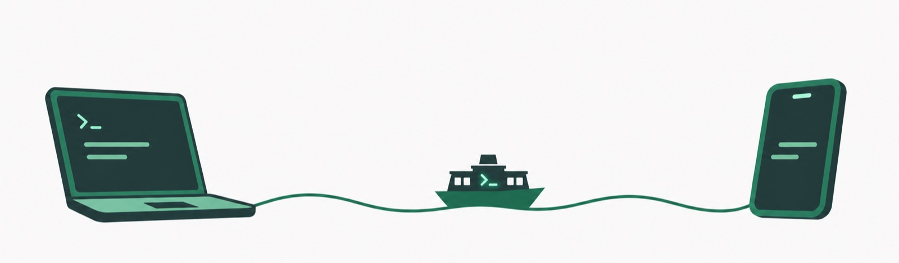

<p align="center">
  <picture>
    <source media="(prefers-color-scheme: dark)" srcset="docs/assets/logo-dark.svg">
    
  </picture>
</p>

<p align="center"><strong>Your coding agents, ferried to any screen.</strong></p>

<p align="center">
  English · <a href="README.zh-CN.md">简体中文</a>
</p>

<p align="center"></p>

Ferry lets you drive the agent CLIs already installed on your own machines (**Codex**, **Claude Code** and **Antigravity**) from any browser, including your phone. Ferry runs each agent through its own native protocol and adds nothing on top.

## Principles

**1. Fast to use, fast to change.**
Setup takes one command, and you can switch between projects and chats with `⌘K`. Replies stream in, and you can steer a turn while it runs. The code is plain Node.js with two runtime dependencies, no framework and no build step. Each adapter is a thin translation layer, so supporting a new CLI release is a small patch. Next, we plan to let AI agents triage issues and follow upstream CLI releases automatically.

**2. Native harness, nothing added.**
We don't build a harness; we carry one. Ferry talks to the Codex App Server and to the `stream-json` interfaces of Claude Code and Antigravity. It adds no system prompts, wrapper instructions or extra tools. Your `AGENTS.md` / `CLAUDE.md`, skills, MCP servers, models, logins and sandbox settings work exactly as they do in the terminal. The only text Ferry ever adds is the file path of an attached video, because no CLI accepts video natively.

**3. Remote by design.**
The Web service and the execution hosts deploy separately. The Web service holds no chats; it serves the UI and relays requests. Each host runs next to its agent CLIs and keeps its own history in SQLite. You can add any number of machines with a one-time pairing code and see them all in one sidebar. If the browser disconnects, Ferry replays the missed events when it reconnects.

## Features

- **Projects and standalone chats** on any folder of any machine, with pinning, archiving, renaming and `⌘K` quick switch.
- **Live turns.** Replies stream in, tool activity appears in order, and you can stop a turn or send *guidance* mid-turn (Codex `turn/steer`, Claude Code stream input).
- **Native questions.** When an agent asks you something (Claude Code `AskUserQuestion`, Codex `requestUserInput`), the question appears as a form and your answer goes back to the agent.
- **Images and video.** Attach up to 6 images per message. Images the agent generates or links from the project are previewed inline.
- **Fork and side chat.** Fork a chat into a new one through each agent's native fork, or ask a read-only side question while the main chat keeps running.
- **Scheduled tasks.** Send a prompt to a chat once or on a repeat interval.
- **Account quota.** Shows each machine's native Codex, Claude Code and Antigravity usage windows.
- **Shared Codex threads.** When Codex Desktop runs an App Server on the same machine, Ferry connects to it, so you can continue the same thread in both places.
- **Notifications** when a turn ends. The UI is in English and Chinese.

## How it works

```
 Browser (desktop · tablet · phone)
        │  HTTPS or private network
        ▼
 Web service ─ UI, sign-in, relay, pairing credentials (no chat data)
        │  HTTP + bearer token
        ├──────────────────┬──────────────────┐
        ▼                  ▼                  ▼
 Host · macOS        Host · Linux        Host · …       ← one per machine, SQLite
        │  native protocols
        ▼
 Codex App Server · Claude Code (stream-json) · Antigravity CLI (stream-json)
```

## Quick start (one machine)

Requirements: **Node.js 22.20+**, and at least one agent CLI installed and signed in: `codex`, `claude` or `agy`. On macOS, Ferry also finds the Codex binary bundled with the ChatGPT and Codex desktop apps.

```sh
git clone https://github.com/caijialin0626/ferry.git && cd ferry
npm install
npm run setup     # writes host.env and web.env with random secrets and prints your access code
npm run host      # terminal 1
npm run web       # terminal 2
```

Open <http://127.0.0.1:8787>, enter the access code, pick a folder and start chatting.

## Remote setup

Run the **Web service** on any server and an **execution host** on every machine that has agent CLIs. Connect them over a private network such as Tailscale, WireGuard or your LAN, or put HTTPS in front.

**Web service (Docker):**

```sh
cp web.env.example web.env   # set FERRY_WEB_LOGIN_TOKEN and FERRY_WEB_ORIGIN
docker compose up -d --build
```

**Each execution host:**

```sh
cp host.env.example host.env # set FERRY_HOST_TOKEN and bind to a private address, e.g. FERRY_HOST_BIND=100.x.y.z
npm install && npm run host
```

**Pair a host:** run `npm run pair` on the host to get a one-time 8-digit code (valid for 10 minutes). In the UI, open **Machines → Add machine** and enter the host address (for example `http://100.x.y.z:8788`) and the code. The Web service stores its own credential for that host; hosts keep only a hash of it.

To run the host as a background service, start `npm run host` from the repository folder with launchd (macOS), systemd (Linux) or a process manager of your choice.

## Configuration

All settings are environment variables. `npm run host`, `npm run pair` and `npm run web` load `host.env` / `web.env` automatically.

**Execution host**

| Variable | Default | Description |
| --- | --- | --- |
| `FERRY_HOST_TOKEN` | — (required) | Shared secret (≥ 24 chars) for a Web service configured with `FERRY_HOST_URL`. |
| `FERRY_HOST_BIND` | `127.0.0.1` | Listen address. Use a private address when the Web service runs elsewhere. |
| `FERRY_HOST_PORT` | `8788` | Listen port. |
| `FERRY_HOST_DATA` | `~/.local/share/ferry/host` | SQLite database, attachments and pairing credentials. Use the same value for `npm run pair`. |
| `FERRY_CODEX_BIN` / `FERRY_CLAUDE_BIN` / `FERRY_AGY_BIN` | auto | Paths to the agent CLIs. |
| `FERRY_CODEX_APP_SERVER_SOCKET` | `$CODEX_HOME/app-server-control/app-server-control.sock` | Shared Codex App Server socket. |
| `FERRY_CLAUDE_HISTORY_DIR` | `$CLAUDE_CONFIG_DIR/projects` | Native Claude Code transcripts, used to restore older replies. |

**Web service**

| Variable | Default | Description |
| --- | --- | --- |
| `FERRY_WEB_LOGIN_TOKEN` | — (required) | Browser access code (≥ 24 chars). Not used in Tailscale mode. |
| `FERRY_WEB_BIND` / `FERRY_WEB_PORT` | `127.0.0.1` / `8787` | Listen address and port. |
| `FERRY_WEB_ORIGIN` | `http://BIND:PORT` | Public origin users open. Requests for any other host are rejected. |
| `FERRY_WEB_DATA` | `~/.local/share/ferry/web` | Pairing credentials. |
| `FERRY_HOST_URL` + `FERRY_HOST_TOKEN` | — | Optional primary host. Without them, Ferry uses paired machines only. |
| `FERRY_EXTRA_HOSTS` | `[]` | Static extra hosts: `[{"id":"lab","url":"http://…:8788","token":"…"}]`. |
| `FERRY_TAILSCALE_LOGIN` | — | Trust the `Tailscale-User-Login` header from `tailscale serve` for this login instead of an access code. Requires loopback bind and an HTTPS origin. |

**Multiple agent accounts.** To read quota for extra login directories, place a `quota-profiles.json` file in the host data directory:

```json
{
  "codex": [{ "name": "Work", "directory": "/home/me/.codex-work" }],
  "claude": [{ "name": "Personal", "directory": "/home/me/.claude-personal", "executable": "/usr/local/bin/claude" }]
}
```

## Security

Ferry runs agents **without per-action approval prompts**: Claude Code in `bypassPermissions` mode, Codex with `approvalPolicy: never` inside the sandbox configured on the host, and Antigravity in always-proceed mode. Anyone who can sign in to the Web service can run commands on your hosts.

- Keep both services on a private network or behind HTTPS. Hosts speak plain HTTP.
- Use long random secrets; `npm run setup` generates them.
- Hosts only start agents with the credentials already present on that machine. Ferry never stores model API keys.

## Development

```sh
npm run check   # syntax check
npm test        # integration tests with fake agent CLIs, no accounts needed
```

The code is small on purpose:

| Path | Purpose |
| --- | --- |
| `src/agents.mjs` | Native adapters for Codex, Claude Code and Antigravity |
| `src/host.mjs` | Execution host: API, turn runner, SSE event stream |
| `src/web.mjs` | Web service: sign-in, relay, pairing |
| `src/db.mjs` | SQLite schema (`node:sqlite`) |
| `public/` | The UI: vanilla JS with no build step. Translations are in `public/i18n.js` |

Contributions are welcome, especially adapter updates for new CLI releases and new languages.

## License

[MIT](LICENSE)
