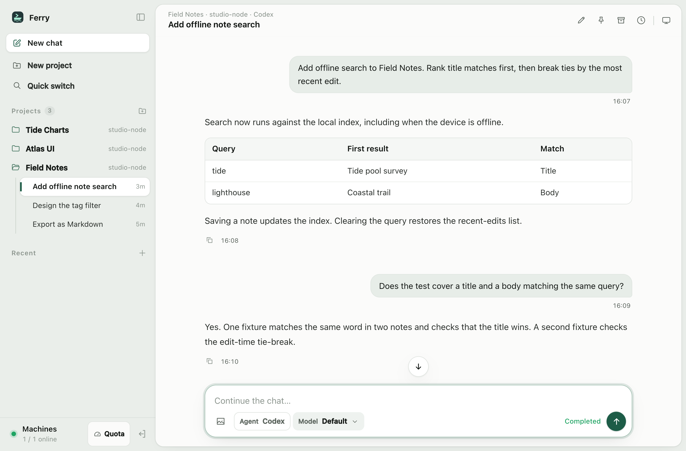
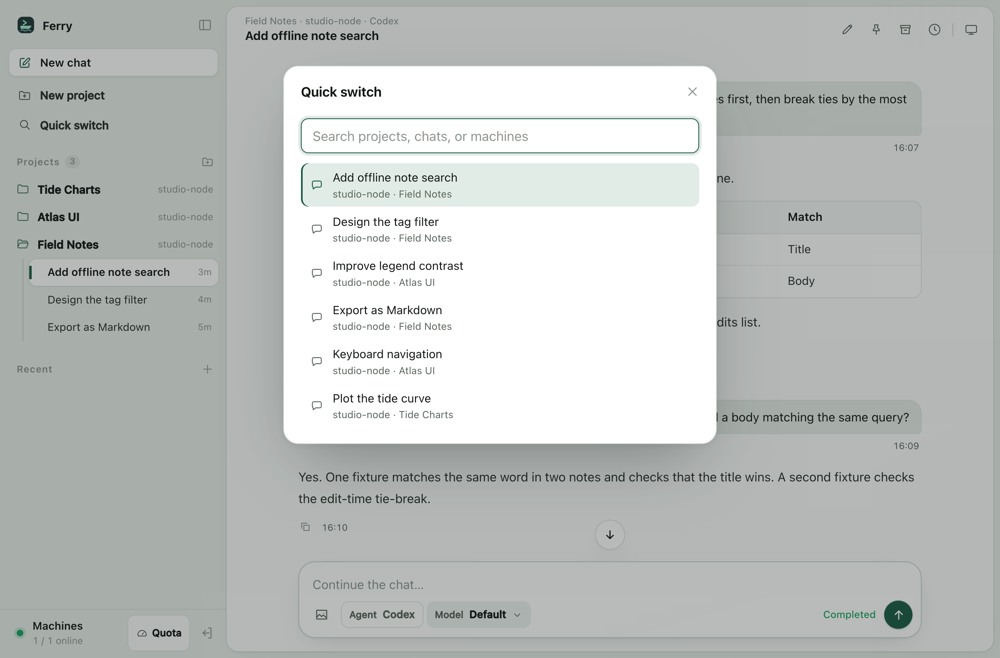
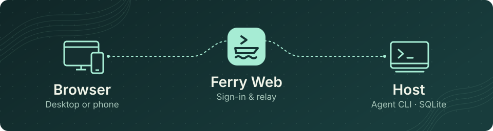

<picture>
  <source media="(prefers-color-scheme: dark)" srcset="docs/assets/logo-dark.svg">
  
</picture>

Ferry brings the **native Codex, Claude Code, and Antigravity CLIs** to your browser. Pick up a chat in any browser and the agent keeps working on your machine with the same project instructions, skills, and tools.

[简体中文](README.zh-CN.md) · [Deployment guide](docs/deployment.md) · [MIT](LICENSE)

> **If you’re an agent deploying Ferry**, use the machines and ports the user requested. Run `all` on one machine, or run `host` and `web` on their respective machines. On each execution host, [import the user’s pinned native chats](docs/deployment.md#import-pinned-chats) and check that they appear under **Pinned** in Ferry. Verify the services and tell the user how to connect and stop them.

Install Git, npm, and Node.js 22.20+ on each machine. The execution host also needs a signed-in agent CLI.

**Start both** · The Web service connects to the local host automatically.

```sh
npx --yes github:caijialin0626/ferry#main all --web-port 8787 --host-port 8788
```

**Execution host only** · Run on the machine with the agent CLIs.

```sh
npx --yes github:caijialin0626/ferry#main host --port 8788
```

**Web only** · Run on the machine serving the browser interface.

```sh
npx --yes github:caijialin0626/ferry#main web --port 8787
```

Standalone services select a private IP and print their address. Use `--bind` to pick another interface. Ports are optional and configurable. Open the URL printed by Web and sign in with the code from the indicated file. For a split deployment, open **Machines → Add machine** and enter the host URL and its printed 8-digit pairing code.

## Workspace preview

In this sample Field Notes project, the sidebar lists projects and chats alongside a Codex conversation about offline search.



<details>
<summary>See the quick switcher</summary>



</details>

- **Steer a live session.** Follow replies and tool calls, add guidance mid-turn, or answer the agent’s questions. Reconnecting replays the events you missed.
- **Attach files.** Click the paperclip or drop files into the composer to send images, videos, ZIP archives, and other files to Codex, Claude Code, or Antigravity.
- **Switch machines.** Pair another host with a one-time code and pick its projects from the sidebar. Each host uses its own models, skills, and MCP configuration.
- **Explore a side question.** Fork a conversation or open a read-only side chat while the main task runs.

## Design principles

- **Quick to use, quick to change.** Start with one command and switch chats with `⌘K` or `Ctrl+K`. Small CLI adapters make upstream changes easier to follow. GitHub Actions checks all three CLIs for new stable releases daily. Codex compares their release notes with Ferry’s adapters and proposes fixes for changes such as a new model catalog format or a renamed flag.
- **Carry the native harness.** Ferry forwards instructions through Codex App Server, Claude Code’s `stream-json` interface, and Antigravity’s Agent Client Protocol (ACP) without adding a system prompt.
- **Remote from the start.** Web handles sign-in and relays requests. Each host runs its agents and keeps its chat history. Deploy both on one machine or put them on separate machines.



The combined command binds to loopback by default. For phone access or multiple machines, see the [remote deployment guide](docs/deployment.md#connect-from-another-device). Anyone who can sign in can run commands on the host without per-action approval.

## Automated issue handling

When you open an issue, describe the behavior you expect and include steps to reproduce any bug. Codex triages new issues in GitHub Actions, implements fixes it can handle, and opens a PR. The workflow posts its automated review and end-to-end test results on the PR and the original issue. A maintainer reviews and merges the PR manually. [Workflow details](.github/maintenance/README.md)
