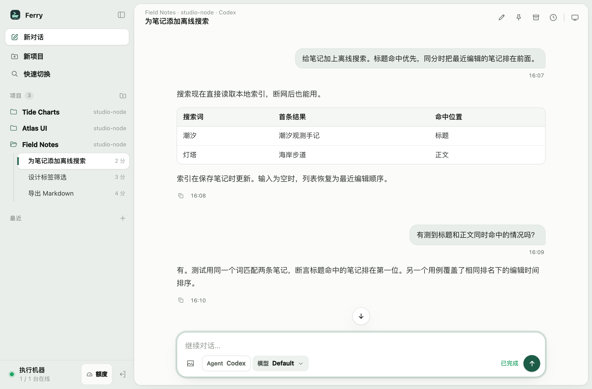
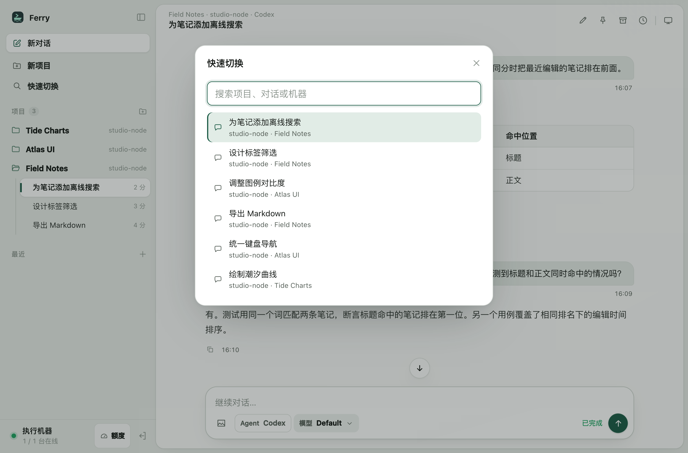
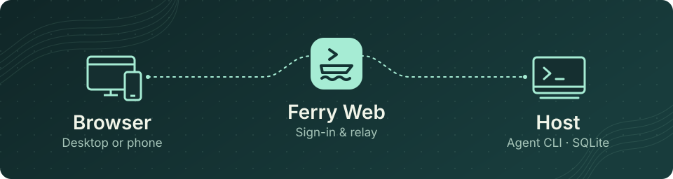

<picture>
  <source media="(prefers-color-scheme: dark)" srcset="docs/assets/logo-dark.svg">
  
</picture>

Ferry 把 **Codex、Claude Code 和 Antigravity 的原生 CLI** 接到浏览器。在浏览器里继续对话时，Agent 仍在你的机器上工作，沿用项目指令、技能和工具。

**对 AI Agent 友好**，也体现在部署上。Agent 读这份 README 就能选择启动方式，通过终端给出的地址和凭据位置完成登录或配对。

[English](README.md) · [部署手册](docs/deployment.zh-CN.md) · [MIT](LICENSE)

> **如果你是负责部署 Ferry 的 Agent**，按用户指定的机器和端口选择启动方式。两端在同一台机器上时用 `all`，分开时在各自机器上运行 `host` 和 `web`。部署完成后，验证已启动的服务，并告诉用户连接方式和停止命令。

需要 Git、npm 和 Node.js 22.20+。运行执行机的机器还需要一个已登录的 Agent CLI。

**一起启动** · Web 和执行机自动连接。

```sh
npx --yes github:caijialin0626/ferry#main all --web-port 8787 --host-port 8788
```

**只启动执行机** · 在装有 Agent CLI 的机器上运行。

```sh
npx --yes github:caijialin0626/ferry#main host --port 8788
```

**只启动 Web** · 在提供浏览器界面的机器上运行。

```sh
npx --yes github:caijialin0626/ferry#main web --port 8787
```

分开部署会自动选择私网 IP 并打印地址。多网卡机器可用 `--bind` 指定地址。端口可改，也可省略。打开 Web 打印的网址，用终端提示的访问码文件登录。分开部署时，在 **执行机器 → 添加执行机** 中填入执行机地址和它打印的 8 位配对码。

## 工作区预览

在示例项目 Field Notes 中，左侧切换项目和对话，右侧查看 Codex 的回复与测试结果。



<details>
<summary>查看快速切换面板</summary>



</details>

- **实时对话。** 看实时回复和工具调用，中途补充一句指令，或回答 Agent 的提问。断线重连后会补上错过的内容。
- **多机切换。** 用一次性配对码接入另一台执行机，通过侧栏切换项目。每台机器沿用自己的模型、技能和 MCP 配置。
- **对话分支。** 从当前对话分叉，或者让主任务继续跑，在旁边开个只读对话查一个问题。

## 设计理念

- **用起来快，迭代也快。** 一条命令启动，`⌘K` 或 `Ctrl+K` 切换对话。每个 CLI 的适配器都很薄，方便跟进上游变化。后续也会考虑自动跟进 Agent CLI 更新。
- **做 harness 的搬运工。** Ferry 通过 Codex App Server、Claude Code 和 Antigravity 的 `stream-json` 接口转发指令，不额外叠加系统提示词。
- **从一开始就支持远程。** Web 端负责登录和转发，执行机负责运行 Agent 和保存对话。两端可以在同一台机器上启动，也可以各自部署。



单机入口默认只允许本机访问。要从手机连接或部署多台机器，请看[远程部署](docs/deployment.zh-CN.md#从另一台设备登录)。能登录的人可以在执行机上运行命令，Agent 执行操作时不会逐项请求批准。

## Issue 自动处理

提交 issue 时请写清预期行为，报告 bug 时也请附上复现步骤。GitHub Actions 会让 Codex 筛选新 issue，为适合自动处理的问题编写修复并创建 PR。独立审查和端到端测试均通过后，工作流会自动合入。开发进度、PR 链接和合入结果都能在原 issue 里看到。[查看工作流说明](.github/maintenance/README.md)
